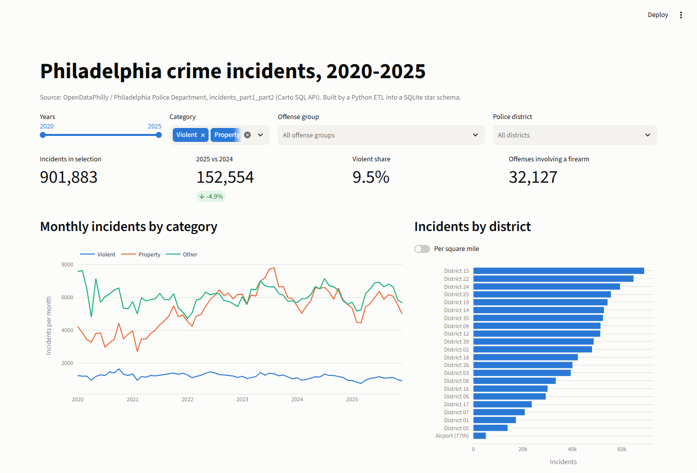
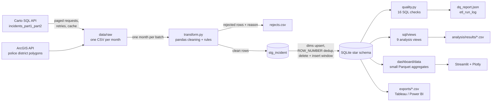
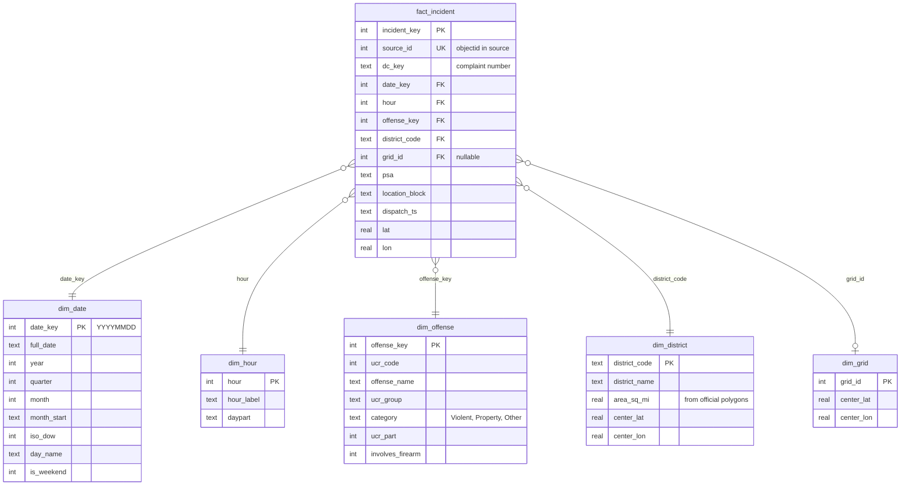
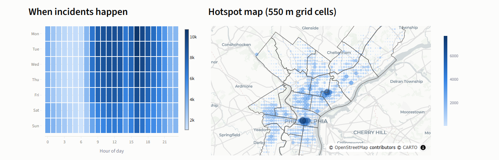

# Philadelphia Crime Warehouse

An end-to-end data pipeline that pulls six years (2020-2025) of Philadelphia
police incident data from the city's public API, cleans and validates it with
pandas, loads it into a SQLite star schema, and answers questions about it with
SQL. A Streamlit dashboard sits on top, and a flat CSV export is ready for
Tableau or Power BI.



## The problem

The city publishes every reported Part I and Part II offense through
OpenDataPhilly, but the raw table is hard to analyze as is. Offense names are
spelled several ways, about 18,000 rows have no coordinates, the `hour` column
is blank for about 100,000 rows, a handful of complaints appear twice, and there
is no calendar or offense hierarchy to group by. This project turns that table
into a small, tested warehouse that answers questions like:

- Is crime going up or down, month over month and year over year?
- Which offenses drive each police district's volume?
- When during the week do incidents cluster?
- Which street blocks show up year after year?

## Architecture



- **Extract** (`src/phl_crime/extract.py`): one SQL query per calendar month,
  paged with `LIMIT/OFFSET`, through a `requests` session with exponential
  backoff on 429 and 5xx responses. Each month is cached to disk with an atomic
  rename, so a rerun after a network failure only fetches what is missing.
- **Transform** (`src/phl_crime/transform.py`): a pure function over one
  DataFrame, so it is easy to unit test. It casts types, trims and nulls blanks,
  standardizes offense names, rejects rows that cannot be placed in the schema
  (each with one reason), drops duplicate complaint + offense pairs, nulls
  coordinates outside Philadelphia instead of dropping the incident, and derives
  date keys, hours, and grid cells.
- **Load** (`src/phl_crime/load.py`, `sql/load/`): batches go to a staging
  table, then one transaction builds the calendar with a recursive CTE, upserts
  the dimensions, deletes the fact rows for the load window, and reinserts them.
  Running the pipeline twice gives the same warehouse.
- **Memory**: the 900,000-row extract is never fully in memory. Each monthly
  batch is cleaned and staged on its own. Duplicates that span two batches are
  caught in SQL with `ROW_NUMBER()` and logged as rejects like the rest.

## Schema



The full DDL is in [`sql/schema.sql`](sql/schema.sql). Foreign keys are enforced
(`PRAGMA foreign_keys = ON` on every connection), the fact table has `UNIQUE`
constraints on `source_id` and on `(dc_key, offense_key)`, and there are indexes
on every foreign key plus `location_block`. Two metadata tables,
`etl_run_log` and `dq_reject_summary`, record every run.

## SQL analysis

Each view in [`sql/views/`](sql/views) starts with a comment saying which
question it answers. `python scripts/run_analysis.py` runs them all and writes
the results to [`analysis/results/`](analysis/results).

| View | Question | Techniques |
|---|---|---|
| `v_monthly_trend` | Monthly volume, year-over-year change, 3-month rolling average | CTE, `LAG(12)`, framed `AVG() OVER`, named `WINDOW` |
| `v_top_offenses_by_district` | Top 5 offense groups per district and their share | `RANK() OVER (PARTITION BY)`, windowed `SUM` |
| `v_hour_weekday_heatmap` | Incidents per weekday x hour, indexed to the average cell | two-dimension `GROUP BY`, `AVG() OVER ()` |
| `v_district_share` | Each district's share of the city per year, per square mile | `SUM() OVER (PARTITION BY year)`, `RANK()` |
| `v_district_yoy_change` | Which districts improved or worsened the most | `LAG()` by district, `RANK()` on percent change |
| `v_offense_risers_fallers` | Offense groups that rose or fell most in the latest year | `FILTER` aggregates, `RANK()` in both directions |
| `v_repeat_location_hotspots` | Blocks with incidents in every year | several CTEs, `ROW_NUMBER()` as a mode, `DENSE_RANK()`, running `SUM()` |
| `v_category_yearly` | Violent / property / other by year and firearm share | `FILTER`, `LAG()`, windowed share |
| `v_grid_hotspots` | Densest map cells and their percentile | `PERCENT_RANK()`, `NTILE(10)` |

## Data quality

Every row that enters the transform ends up in exactly one place: the fact
table or `rejects.csv` with a reason. After loading, `quality.py` runs 16 SQL
checks and the run fails if any of them do:

- `PRAGMA foreign_key_check` is empty and no fact row has an orphan key
- no duplicate `source_id`, no duplicate complaint + offense
- every date inside the load window and none in the future
- `date_key` and `hour` agree with the dispatch timestamp
- every coordinate inside the Philadelphia bounding box, and never only one of lat / lon
- no empty months and no month below half the median monthly volume
- fact row count equals the rows that passed the transform and dedup

The report for the full run is committed at
[`docs/dq_report_full_run.json`](docs/dq_report_full_run.json).

## Results of the full 2020-2025 run

| Step | Rows |
|---|---|
| Rows reported by the API for 2020-2025 | 901,977 |
| Rows extracted (72 monthly files) | 901,977 |
| Rejected: duplicate complaint + offense | 93 (88 within a month, 5 across months) |
| Rejected: invalid police district | 1 |
| **Loaded into `fact_incident`** | **901,883** |
| Kept, coordinates nulled (18,388 missing, 369 outside the city) | 18,757 |
| Source `hour` blank (hour re-derived from dispatch time) | 102,176 |

All 16 checks passed. With the raw files already cached, the run took 73 seconds
on a laptop: 29 s transform, 20 s load, 3 s checks, 20 s dashboard export. The
warehouse file is about 325 MB. The first download of all 72 months took about
four minutes.

### Findings

1. **Total incidents peaked in 2023 and have fallen since.** 168,996 incidents
   in 2023, 160,379 in 2024, and 152,554 in 2025, a 9.7% drop from the peak.
2. **Violent offenses fell three years in a row, and fewer involve a firearm.**
   Violent incidents went from 15,199 in 2022 to 12,019 in 2025 (down 20.9%).
   The share of violent incidents involving a firearm fell from 41.8% to 29.2%,
   and homicides fell from 259 in 2024 to 213 in 2025.
3. **The 2021-2023 rise was mostly property crime.** Property incidents went from
   43,744 in 2020 to 78,903 in 2023 (up 80%), then down to 66,305 in 2025. Theft
   alone fell by 4,603 incidents from 2024 to 2025, the largest drop of any group.
4. **Weekday afternoons are the busiest time.** The 4 pm hour has the most
   incidents (66,004 over six years). The Monday 4 pm cell is 1.99 times the
   average weekday-hour cell, while Saturday and Sunday at 6 am sit at 0.20.
5. **A few blocks recur every month.** The 5500 block of Tulip St had 2,082
   incidents and at least one in all 72 months, mostly theft. The ten busiest
   repeat blocks account for 1.5% of all incidents in the city.

A data note that came out of the district views: District 06 stops appearing
partway through 2024 and District 09's volume roughly doubles at the same time
(7,016 in 2023, 12,415 in 2024). The current boundary file has 21 districts and
no 06, so district comparisons that span 2024 should be read with that in mind.

## Dashboard

`dashboard/app.py` is a Streamlit + Plotly app with filters for years,
category, offense group, and district; KPI cards; a monthly trend; a district
comparison (raw or per square mile); a weekday x hour heatmap; a hotspot map with
district boundaries; and the repeat-block table. It reads only the small
aggregate files in `dashboard/data` (under 1 MB), so it runs on Streamlit
Community Cloud without the database.



Full page: [docs/img/dashboard_full.png](docs/img/dashboard_full.png)

## How to run

Requires Python 3.11+. No database server or Docker needed.

```bash
python -m venv .venv
source .venv/bin/activate          # Windows: .venv\Scripts\activate
pip install -e ".[dev,dashboard]"

# Full pipeline: download 2020-2025 (cached), transform, load, check, export
python -m phl_crime.pipeline run --check-source

# SQL analysis views -> analysis/results/*.csv
python scripts/run_analysis.py

# Flat CSVs for Tableau / Power BI -> exports/
python scripts/export_bi.py

# Dashboard
streamlit run dashboard/app.py

# Tests (no network needed; builds a warehouse from the committed fixture)
pytest

# Same data-quality tests against the full warehouse
PHL_TEST_DB=data/warehouse.db pytest tests/test_warehouse.py
```

Useful options: `START_YEAR` / `END_YEAR` environment variables change the
window, `--raw-file` loads a local CSV or Parquet file instead of calling the
API, and `--chunk-rows` caps the batch size.

## Testing and CI

There are 60 tests. Unit tests cover each transform rule with small hand-built
rows, extract paging and caching with the network mocked out, and the district
area math. Warehouse tests build a database from a committed 3,008-row fixture
(a real sample plus eight deliberately broken rows) and check row counts against
the ETL log, foreign keys, duplicates, date range, coordinates, the view math,
idempotent reloads, and cross-batch dedup.

GitHub Actions (`.github/workflows/ci.yml`) runs `ruff check`, `ruff format
--check`, `pytest`, then an end-to-end ETL run on the fixture and the
data-quality tests against that build. The DQ report is uploaded as an artifact.

## Project layout

```
src/phl_crime/     extract, transform, load, quality, export, analysis, pipeline CLI
sql/schema.sql     star schema DDL
sql/load/          calendar build and fact reload
sql/views/         analysis views, one question each
analysis/results/  view output from the full run
dashboard/         Streamlit app and its small data files
scripts/           analysis, BI export, fixture builder, screenshots
tests/             unit, extract, and warehouse tests plus the fixture sample
```

## Limitations

- These are reported incidents, not all crime. Reporting rates differ by
  offense and neighborhood, and the source is revised after publication, so a
  later pull can give slightly different counts.
- Rates are per square mile, not per resident. There is no population join yet.
- The District 06 / 09 change in 2024 affects any district trend across that year.
- About 2% of incidents have no usable coordinates and are left off the map
  (they still count everywhere else).
- Grid cells are a simple 0.005 degree lattice, not a proper hexbin or kernel density.
- SQLite fits a single-user analytical workload of this size well; a shared
  team warehouse would move the same schema to Postgres or a cloud warehouse.

## Data source

City of Philadelphia, Philadelphia Police Department, *Crime Incidents*
(`incidents_part1_part2`) via the OpenDataPhilly Carto SQL API
(https://phl.carto.com/api/v2/sql), and police district boundaries from the
city's ArcGIS service. Both are public.

## License

MIT. See [LICENSE](LICENSE).
